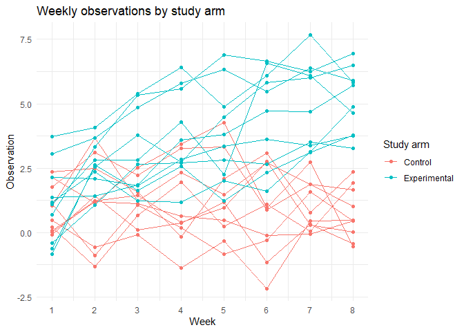
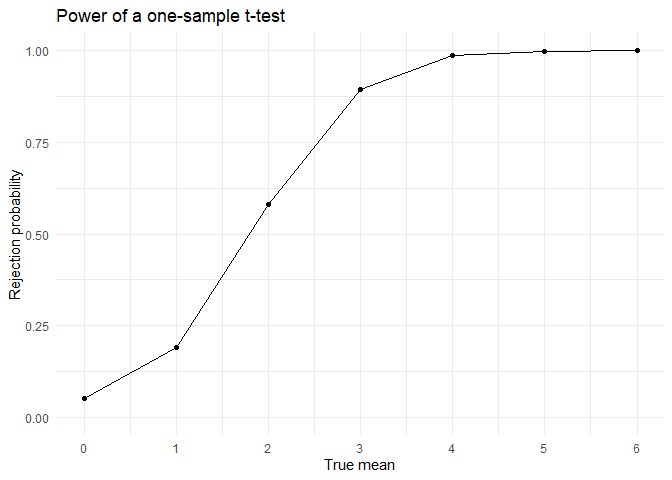
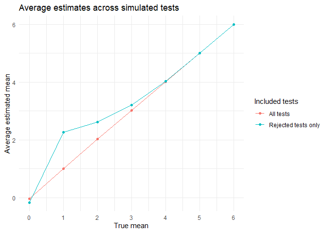

Homework 5
================

``` r
library(tidyverse)
```

    ## ── Attaching core tidyverse packages ──────────────────────── tidyverse 2.0.0 ──
    ## ✔ dplyr     1.2.1     ✔ readr     2.2.0
    ## ✔ forcats   1.0.1     ✔ stringr   1.6.0
    ## ✔ ggplot2   4.0.3     ✔ tibble    3.3.1
    ## ✔ lubridate 1.9.5     ✔ tidyr     1.3.2
    ## ✔ purrr     1.2.2     
    ## ── Conflicts ────────────────────────────────────────── tidyverse_conflicts() ──
    ## ✖ dplyr::filter() masks stats::filter()
    ## ✖ dplyr::lag()    masks stats::lag()
    ## ℹ Use the conflicted package (<http://conflicted.r-lib.org/>) to force all conflicts to become errors

``` r
set.seed(1)
```

## Problem 1

``` r
source("source/birthday_sim.R")

birthday_sim(n = 10)
```

    ## [1] FALSE

``` r
birthday_results =
  expand_grid(
    n = 10,
    iter = 1:10000
  ) |>
  mutate(
    shared_birthday = map(n, birthday_sim)
  ) |>
  unnest(shared_birthday)


birthday_results |>
  summarise(
    probability = mean(shared_birthday)
  )
```

    ## # A tibble: 1 × 1
    ##   probability
    ##         <dbl>
    ## 1       0.122

``` r
birthday_results =
  expand_grid(
    n = 2:50,
    iter = 1:10000
  ) |>
  mutate(
    shared_birthday = map(n, birthday_sim)
  ) |>
  unnest(shared_birthday)

birthday_summary =
  birthday_results |>
  group_by(n) |>
  summarise(
    probability = mean(shared_birthday),
    .groups = "drop"
  )
```

``` r
birthday_summary |>
  ggplot(aes(x = n, y = probability)) +
  geom_line() +
  geom_point() +
  scale_y_continuous(limits = c(0, 1)) +
  labs(
    title = "Probability of a shared birthday",
    x = "Group size",
    y = "Estimated probability"
  ) +
  theme_minimal()
```

<!-- -->

Assuming independent birthdays uniformly distributed across 365 days, I
ran 10000 simulations for each group size from 2 to 50. The estimated
probability of at least one shared birthday increased with group size,
reaching 50.6% for 23 people and 97.2% for 50 people. As group size
increases, the number of possible pairs grows, creating more
opportunities for a shared birthday.

## Problem 2

``` r
study_files =
  tibble(
    file_name = list.files("hw5_data/data")
  )

study_files =
  study_files |>
  mutate(
    file_path = str_c("hw5_data/data/", file_name),
    data = map(file_path, read_csv, show_col_types = FALSE)
  )

study_files
```

    ## # A tibble: 20 × 3
    ##    file_name  file_path                data              
    ##    <chr>      <chr>                    <list>            
    ##  1 con_01.csv hw5_data/data/con_01.csv <spc_tbl_ [1 × 8]>
    ##  2 con_02.csv hw5_data/data/con_02.csv <spc_tbl_ [1 × 8]>
    ##  3 con_03.csv hw5_data/data/con_03.csv <spc_tbl_ [1 × 8]>
    ##  4 con_04.csv hw5_data/data/con_04.csv <spc_tbl_ [1 × 8]>
    ##  5 con_05.csv hw5_data/data/con_05.csv <spc_tbl_ [1 × 8]>
    ##  6 con_06.csv hw5_data/data/con_06.csv <spc_tbl_ [1 × 8]>
    ##  7 con_07.csv hw5_data/data/con_07.csv <spc_tbl_ [1 × 8]>
    ##  8 con_08.csv hw5_data/data/con_08.csv <spc_tbl_ [1 × 8]>
    ##  9 con_09.csv hw5_data/data/con_09.csv <spc_tbl_ [1 × 8]>
    ## 10 con_10.csv hw5_data/data/con_10.csv <spc_tbl_ [1 × 8]>
    ## 11 exp_01.csv hw5_data/data/exp_01.csv <spc_tbl_ [1 × 8]>
    ## 12 exp_02.csv hw5_data/data/exp_02.csv <spc_tbl_ [1 × 8]>
    ## 13 exp_03.csv hw5_data/data/exp_03.csv <spc_tbl_ [1 × 8]>
    ## 14 exp_04.csv hw5_data/data/exp_04.csv <spc_tbl_ [1 × 8]>
    ## 15 exp_05.csv hw5_data/data/exp_05.csv <spc_tbl_ [1 × 8]>
    ## 16 exp_06.csv hw5_data/data/exp_06.csv <spc_tbl_ [1 × 8]>
    ## 17 exp_07.csv hw5_data/data/exp_07.csv <spc_tbl_ [1 × 8]>
    ## 18 exp_08.csv hw5_data/data/exp_08.csv <spc_tbl_ [1 × 8]>
    ## 19 exp_09.csv hw5_data/data/exp_09.csv <spc_tbl_ [1 × 8]>
    ## 20 exp_10.csv hw5_data/data/exp_10.csv <spc_tbl_ [1 × 8]>

``` r
study_subjects =
  study_files |>
  mutate(
    file_name = str_replace(file_name, "\\.csv$", "")
  ) |>
  separate(
    file_name,
    into = c("arm", "subject_id"),
    sep = "_"
  ) |>
  select(arm, subject_id, data)

study_tidy =
  study_subjects |>
  unnest(data) |>
  pivot_longer(
    week_1:week_8,
    names_to = "week",
    names_prefix = "week_",
    values_to = "observation"
  ) |>
  mutate(
    week = as.numeric(week)
  )

study_tidy
```

    ## # A tibble: 160 × 4
    ##    arm   subject_id  week observation
    ##    <chr> <chr>      <dbl>       <dbl>
    ##  1 con   01             1        0.2 
    ##  2 con   01             2       -1.31
    ##  3 con   01             3        0.66
    ##  4 con   01             4        1.96
    ##  5 con   01             5        0.23
    ##  6 con   01             6        1.09
    ##  7 con   01             7        0.05
    ##  8 con   01             8        1.94
    ##  9 con   02             1        1.13
    ## 10 con   02             2       -0.88
    ## # ℹ 150 more rows

``` r
study_tidy |>
  mutate(
    arm = if_else(arm == "con", "Control", "Experimental"),
    participant = str_c(arm, "_", subject_id)
  ) |>
  ggplot(
    aes(x = week, y = observation, group = participant, color = arm)
  ) +
  geom_line() +
  geom_point() +
  scale_x_continuous(breaks = 1:8) +
  labs(
    title = "Weekly observations by study arm",
    x = "Week",
    y = "Observation",
    color = "Study arm"
  ) +
  theme_minimal()
```

<!-- -->

The combined dataset includes 20 participants: 10 in the control arm and
10 in the experimental arm. Each participant was observed over 8 weeks,
yielding 160 participant-week observations. Experimental participants
generally showed increasing observations over time, while control
participants fluctuated without a clear sustained trend. The groups
overlapped initially, but experimental observations were generally
higher in later weeks. Individual variability remained evident in both
arms.

## Problem 3

``` r
source("source/sim_ttest.R")
```

``` r
ttest_results =
  expand_grid(
    mu = 0:6,
    iter = 1:5000
  ) |>
  mutate(
    result = map(mu, sim_ttest)
  ) |>
  unnest(result) |>
  mutate(
    reject = p.value < 0.05
  )

power_summary =
  ttest_results |>
  group_by(mu) |>
  summarise(
    rejection_rate = mean(reject),
    .groups = "drop"
  )

power_summary
```

    ## # A tibble: 7 × 2
    ##      mu rejection_rate
    ##   <int>          <dbl>
    ## 1     0         0.0512
    ## 2     1         0.19  
    ## 3     2         0.579 
    ## 4     3         0.896 
    ## 5     4         0.988 
    ## 6     5         0.999 
    ## 7     6         1.000

``` r
power_summary |>
  ggplot(aes(x = mu, y = rejection_rate)) +
  geom_line() +
  geom_point() +
  scale_x_continuous(breaks = 0:6) +
  scale_y_continuous(limits = c(0, 1)) +
  labs(
    title = "Power of a one-sample t-test",
    x = "True mean",
    y = "Rejection probability"
  ) +
  theme_minimal()
```

<!-- -->

``` r
estimate_summary =
  ttest_results |>
  group_by(mu) |>
  summarise(
    all_tests = mean(estimate),
    rejected_tests = mean(estimate[reject]),
    .groups = "drop"
  )

estimate_summary
```

    ## # A tibble: 7 × 3
    ##      mu all_tests rejected_tests
    ##   <int>     <dbl>          <dbl>
    ## 1     0   -0.0379         -0.168
    ## 2     1    1.00            2.26 
    ## 3     2    2.02            2.61 
    ## 4     3    3.02            3.20 
    ## 5     4    4.01            4.03 
    ## 6     5    5.00            5.00 
    ## 7     6    5.98            5.98

``` r
estimate_summary |>
  pivot_longer(
    all_tests:rejected_tests,
    names_to = "samples",
    values_to = "mean_estimate"
  ) |>
  mutate(
    samples = if_else(
      samples == "all_tests",
      "All tests",
      "Rejected tests only"
    )
  ) |>
  ggplot(
    aes(
      x = mu,
      y = mean_estimate,
      color = samples
    )
  ) +
  geom_line() +
  geom_point() +
  scale_x_continuous(breaks = 0:6) +
  labs(
    title = "Average estimates across simulated tests",
    x = "True mean",
    y = "Average estimated mean",
    color = "Included tests"
  ) +
  theme_minimal()
```

<!-- -->

With sample size and standard deviation fixed, rejection probability
increased as the true mean moved further from zero. At a true mean of 0,
the estimated Type I error rate was 5.1%, close to the nominal 5% level.
At a true mean of 3, estimated power was 89.6%, and it approached 100%
for larger effects.

Across all tests, average estimates were close to the true means. At a
true mean of 1, the average estimate was 1 across all tests, compared
with 2.26 among rejected tests. For small positive effects,
significance-based selection favors unusually large positive estimates,
producing upward selection bias. As power increases, most tests are
retained and the two averages converge. At a true mean of 0, two-sided
rejection selects both positive and negative extremes, so the signed
average remains centered near zero, subject to simulation variability.
