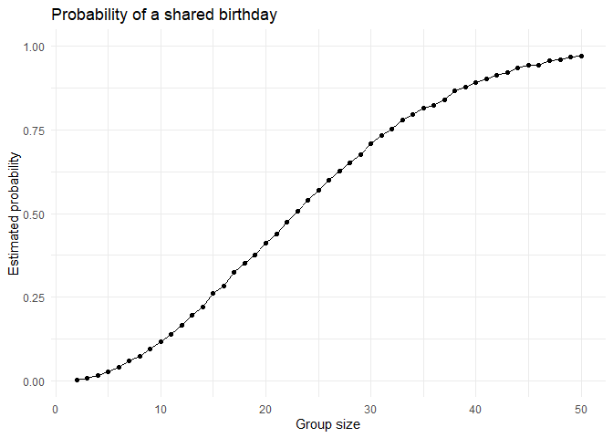

Homework 5
================

``` r
library(tidyverse)
```

    ## ── Attaching core tidyverse packages ──────────────────────── tidyverse 2.0.0 ──
    ## ✔ dplyr     1.2.1     ✔ readr     2.2.0
    ## ✔ forcats   1.0.1     ✔ stringr   1.6.0
    ## ✔ ggplot2   4.0.3     ✔ tibble    3.3.1
    ## ✔ lubridate 1.9.5     ✔ tidyr     1.3.2
    ## ✔ purrr     1.2.2     
    ## ── Conflicts ────────────────────────────────────────── tidyverse_conflicts() ──
    ## ✖ dplyr::filter() masks stats::filter()
    ## ✖ dplyr::lag()    masks stats::lag()
    ## ℹ Use the conflicted package (<http://conflicted.r-lib.org/>) to force all conflicts to become errors

``` r
set.seed(1)
```

## Problem 1

``` r
source("source/birthday_sim.R")

birthday_sim(n = 10)
```

    ## [1] FALSE

``` r
birthday_results =
  expand_grid(
    n = 10,
    iter = 1:10000
  ) |>
  mutate(
    shared_birthday = map(n, birthday_sim)
  ) |>
  unnest(shared_birthday)


birthday_results |>
  summarise(
    probability = mean(shared_birthday)
  )
```

    ## # A tibble: 1 × 1
    ##   probability
    ##         <dbl>
    ## 1       0.122

``` r
birthday_results =
  expand_grid(
    n = 2:50,
    iter = 1:10000
  ) |>
  mutate(
    shared_birthday = map(n, birthday_sim)
  ) |>
  unnest(shared_birthday)

birthday_summary =
  birthday_results |>
  group_by(n) |>
  summarise(
    probability = mean(shared_birthday),
    .groups = "drop"
  )
```

``` r
birthday_summary |>
  ggplot(aes(x = n, y = probability)) +
  geom_line() +
  geom_point() +
  scale_y_continuous(limits = c(0, 1)) +
  labs(
    title = "Probability of a shared birthday",
    x = "Group size",
    y = "Estimated probability"
  ) +
  theme_minimal()
```

<!-- -->

Assuming independent birthdays uniformly distributed across 365 days, I
ran 10000 simulations for each group size from 2 to 50. The estimated
probability of at least one shared birthday increased with group size,
reaching 50.6% for 23 people and 97.2% for 50 people. As group size
increases, the number of possible pairs grows, creating more
opportunities for a shared birthday.

## Problem 2

## Problem 3
